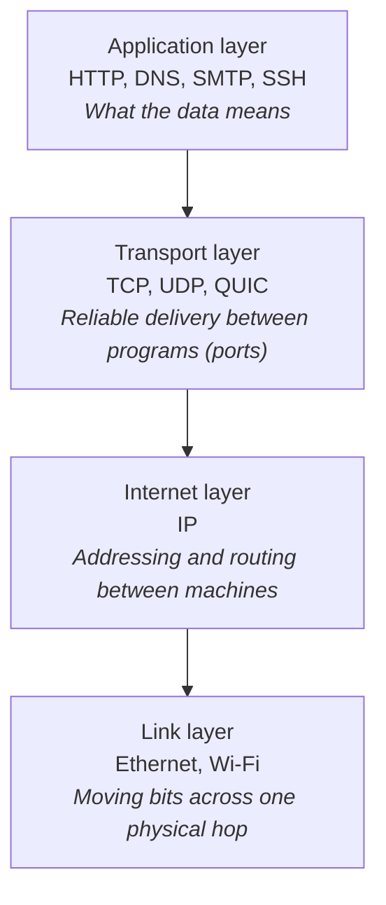
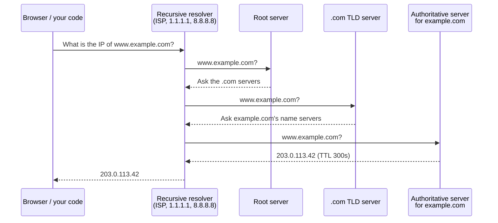
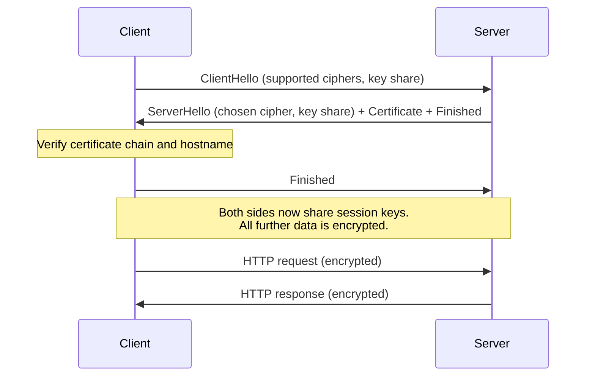
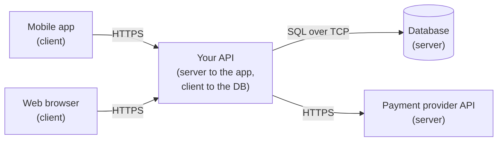
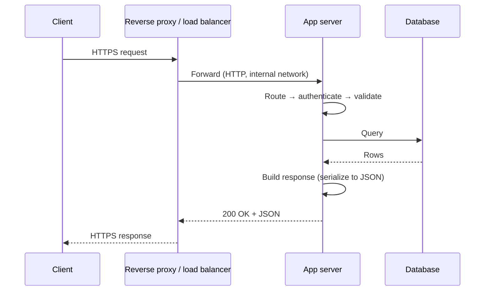
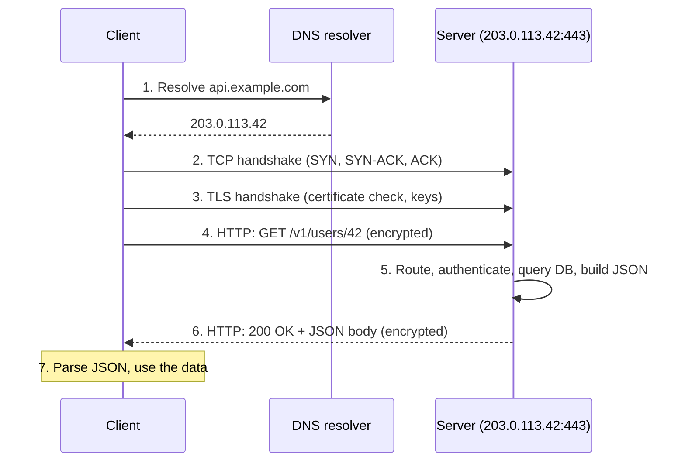

# Web Fundamentals for Backend Developers

A practical, plain-language guide to how the web actually works: from an IP packet to a JSON response.

> **Who this is for:** developers who write server-side code (APIs, services, databases) and want a solid mental model of what happens *around* their code.
>
> **How to read it:** top to bottom the first time. Later, use the table of contents as a reference. Diagrams use [Mermaid](https://mermaid.js.org/), which GitHub renders automatically.

---

## Table of Contents

1. [The Big Picture](#1-the-big-picture)
2. [Networking Foundations: IPs, Ports, DNS, TCP, TLS](#2-networking-foundations)
3. [HTTP in Depth](#3-http-in-depth)
4. [Client and Server: Roles and Interaction](#4-client-and-server-roles-and-interaction)
5. [REST APIs](#5-rest-apis)
6. [JSON](#6-json)
7. [Putting It All Together](#7-putting-it-all-together-what-happens-when-you-open-a-url)
8. [Hands-On Exercises](#8-hands-on-exercises)
9. [Common Pitfalls](#9-common-pitfalls)
10. [Further Reading and References](#10-further-reading-and-references)
11. [Glossary](#11-glossary)

---

## 1. The Big Picture

### The Internet vs. the Web

These two words are often used as if they mean the same thing. They don't.

| | **The Internet** | **The Web (WWW)** |
|---|---|---|
| What it is | A global network of networks that moves packets of data between machines | A system of linked resources (pages, images, APIs) accessed over the Internet |
| Built on | IP, TCP, UDP, and others | HTTP, URLs, HTML |
| Analogy | The road system | Delivery trucks and shops using the roads |
| Other things that use it | Email (SMTP), file transfer (FTP/SFTP), SSH, games, video calls | Websites, REST APIs, web apps |

So when you build a REST API, you're building something on the **Web**, which runs on top of the **Internet**.

### The layer cake

Network communication is organized in **layers**. Each layer solves one problem and relies on the layer below it. You write code at the top; the lower layers are handled by the OS and network hardware.



This is the **TCP/IP model** (four layers). You'll also see the 7-layer **OSI model** in textbooks; it's a teaching tool, while TCP/IP describes what is actually deployed.

When your code sends an HTTP request, it gets **wrapped** by each layer on the way down (encapsulation), and **unwrapped** on the way up at the receiver:

```
[ HTTP message                         ]   <- your request/response
[ TCP header | HTTP message            ]   <- adds ports, sequence numbers
[ IP header | TCP header | HTTP msg    ]   <- adds source/destination IP
[ Ethernet header | IP | TCP | HTTP    ]   <- adds MAC addresses for the next hop
```

---

## 2. Networking Foundations

### 2.1 IP addresses

An **IP address** identifies a network interface so packets can be routed to it.

- **IPv4**: 32 bits, written as four numbers, e.g. `203.0.113.42`. About 4.3 billion addresses, which is not enough for today's world.
- **IPv6**: 128 bits, written in hex, e.g. `2001:db8::1`. Effectively unlimited.

**Public vs. private addresses.** Some IPv4 ranges are reserved for private networks (your home, office, or cloud VPC) and are not routable on the public Internet:

| Range | Typical use |
|---|---|
| `10.0.0.0/8` | Large private networks, cloud VPCs |
| `172.16.0.0/12` | Private networks (Docker uses this a lot) |
| `192.168.0.0/16` | Home routers |
| `127.0.0.0/8` | **Loopback**: `127.0.0.1` / `localhost` means "this machine" |

**NAT (Network Address Translation)** lets many private devices share one public IP. Your router rewrites addresses on the way out and remembers which connection belongs to which device.

**CIDR notation** such as `10.0.0.0/8` means "the first 8 bits are the network part; the rest identify hosts". A `/24` gives 256 addresses, a `/16` gives 65,536.

> **Backend tip:** binding your server to `127.0.0.1` makes it reachable only from the same machine. Binding to `0.0.0.0` means "all interfaces", so it is reachable from outside (if firewalls allow). Getting this wrong is a classic "works locally, not in Docker" bug.

### 2.2 Ports

An IP address gets a packet to the right *machine*. A **port** (0 to 65535) gets it to the right *program* on that machine.

| Port | Protocol |
|---|---|
| 22 | SSH |
| 53 | DNS |
| 80 | HTTP |
| 443 | HTTPS |
| 5432 | PostgreSQL (convention) |
| 3306 | MySQL (convention) |
| 6379 | Redis (convention) |

Ports 0 to 1023 are "well-known" ports and usually require elevated privileges to bind. A **socket** is the combination of IP + port + protocol. A TCP *connection* is uniquely identified by four values: source IP, source port, destination IP, destination port.

### 2.3 DNS: the Internet's phone book

Humans use names (`example.com`); routers use IP addresses. **DNS (Domain Name System)** translates one into the other.



Key points:

- Results are **cached** at many levels (browser, OS, resolver) for the record's **TTL** (time to live). This is why DNS changes can take time to "propagate".
- Common record types:

| Record | Purpose | Example |
|---|---|---|
| `A` | Name → IPv4 address | `example.com → 203.0.113.42` |
| `AAAA` | Name → IPv6 address | `example.com → 2001:db8::1` |
| `CNAME` | Name → another name (alias) | `www → example.com` |
| `MX` | Mail servers for the domain | `10 mail.example.com` |
| `TXT` | Free text (SPF, domain verification) | `"v=spf1 ..."` |
| `NS` | Which servers are authoritative | `ns1.example.com` |

Try it:

```bash
dig example.com          # or: nslookup example.com
dig +short example.com A
```

### 2.4 TCP, UDP, and QUIC

The transport layer moves data between **programs**.

| | **TCP** | **UDP** |
|---|---|---|
| Connection | Yes (handshake first) | No |
| Delivery | Reliable, ordered, retransmits lost packets | Best effort, may be lost or reordered |
| Overhead | Higher | Lower |
| Used for | HTTP/1.1, HTTP/2, databases, SSH, email | DNS queries, video calls, games, **QUIC** (HTTP/3) |

**The TCP three-way handshake** sets up a connection before any data flows:

```mermaid
sequenceDiagram
    participant C as Client
    participant S as Server
    C->>S: SYN (let's talk; my sequence number is x)
    S->>C: SYN-ACK (OK; mine is y, I got x)
    C->>S: ACK (I got y)
    Note over C,S: Connection established, data can flow
```

This costs one **round trip** of latency before your first byte of HTTP is sent, which is why connection reuse (keep-alive) matters so much for performance.

TCP also provides **flow control** (don't overwhelm the receiver) and **congestion control** (don't overwhelm the network).

**QUIC** is a newer transport built on UDP that bundles reliability, encryption, and multiplexing together. It powers HTTP/3.

### 2.5 TLS and HTTPS

**HTTP** sends everything in readable text. Anyone on the path (Wi-Fi owner, ISP, attacker) could read or modify it. **HTTPS** is simply **HTTP inside a TLS connection**.

TLS (Transport Layer Security) provides three things:

1. **Confidentiality**: data is encrypted.
2. **Integrity**: tampering is detected.
3. **Authentication**: the client can verify it is talking to the real `example.com`, using a **certificate** signed by a trusted **Certificate Authority (CA)**.

Simplified TLS 1.3 handshake:



Underneath, TLS uses **asymmetric cryptography** to agree on a secret safely, then switches to fast **symmetric encryption** for the actual data.

> **Backend tip:** terminate TLS at a load balancer or reverse proxy (Nginx, Caddy, cloud LB), or in your app. Use free certificates from [Let's Encrypt](https://letsencrypt.org/). Always redirect HTTP → HTTPS for anything real.

### 2.6 URLs

A **URL** (Uniform Resource Locator) tells a client *where* a resource is and *how* to get it:

```
  https://user@api.example.com:8443/v1/users/42?include=orders&sort=desc#profile
  \___/   \__/ \_____________/ \__/ \__________/ \___________________/ \_____/
    |      |         |          |        |                |               |
 scheme  userinfo   host       port     path            query          fragment
```

| Part | Meaning |
|---|---|
| **scheme** | Protocol to use (`http`, `https`, `ftp`, ...) |
| **host** | Domain name or IP address |
| **port** | Optional; defaults to 80 for http and 443 for https |
| **path** | Which resource on the server |
| **query** | Key/value parameters, starting with `?`, separated with `&` |
| **fragment** | Client-side only. **Never sent to the server** (used for in-page anchors) |

Special characters must be **percent-encoded** (a space becomes `%20`). Spec: [RFC 3986](https://www.rfc-editor.org/rfc/rfc3986).

---

## 3. HTTP in Depth

**HTTP (HyperText Transfer Protocol)** is the application-layer protocol of the Web. It is a **request/response** protocol: the client sends a request, the server sends back exactly one response.

Two properties define how you'll design backends:

- **Text-based semantics** (in HTTP/1.1 the messages are literally readable text; HTTP/2 and 3 encode them in binary but keep the same meaning).
- **Stateless**: each request stands alone. The server does not automatically remember previous requests. (Sessions, cookies, and tokens are layered on top to add "memory".)

### 3.1 Anatomy of a request

```http
POST /v1/users HTTP/1.1
Host: api.example.com
Content-Type: application/json
Accept: application/json
Authorization: Bearer eyJhbGciOi...
Content-Length: 47

{"name": "Ada Lovelace", "email": "ada@example.com"}
```

1. **Request line**: method, target (path + query), HTTP version.
2. **Headers**: `Name: value` metadata lines.
3. **Blank line**: marks the end of headers.
4. **Body** (optional): the payload.

### 3.2 Anatomy of a response

```http
HTTP/1.1 201 Created
Content-Type: application/json
Location: /v1/users/42
Cache-Control: no-store
Content-Length: 71

{"id": 42, "name": "Ada Lovelace", "email": "ada@example.com"}
```

1. **Status line**: version, status code, reason phrase.
2. **Headers**.
3. **Blank line**.
4. **Body** (optional).

### 3.3 Methods (verbs)

The method states the **intent** of the request.

| Method | Meaning | Has body? | Safe? | Idempotent? |
|---|---|---|---|---|
| `GET` | Retrieve a resource | No | Yes | Yes |
| `HEAD` | Like GET, but headers only | No | Yes | Yes |
| `POST` | Submit data / create / trigger processing | Yes | No | **No** |
| `PUT` | Replace a resource entirely (or create at a known URL) | Yes | No | Yes |
| `PATCH` | Partially modify a resource | Yes | No | Not guaranteed |
| `DELETE` | Remove a resource | Usually no | No | Yes |
| `OPTIONS` | Ask what's allowed (used by CORS preflight) | No | Yes | Yes |

Two vocabulary words you must know:

- **Safe**: the request doesn't change server state. Clients (and crawlers, prefetchers, caches) may call safe methods freely. **Never perform state changes in a `GET`.**
- **Idempotent**: doing it once or ten times leaves the server in the same state. This matters when networks fail and clients **retry**. Retrying a `PUT` or `DELETE` is safe; retrying a `POST` might create duplicates (hence **idempotency keys** in payment APIs).

### 3.4 Status codes

Grouped by first digit:

| Range | Meaning | Common codes |
|---|---|---|
| **1xx** | Informational | `101 Switching Protocols` (WebSocket upgrade) |
| **2xx** | Success | `200 OK`, `201 Created`, `202 Accepted`, `204 No Content` |
| **3xx** | Redirection | `301 Moved Permanently`, `302 Found`, `304 Not Modified`, `307/308` (redirect preserving method) |
| **4xx** | **Client** made a mistake | `400 Bad Request`, `401 Unauthorized`, `403 Forbidden`, `404 Not Found`, `405 Method Not Allowed`, `409 Conflict`, `415 Unsupported Media Type`, `422 Unprocessable Content`, `429 Too Many Requests` |
| **5xx** | **Server** failed | `500 Internal Server Error`, `502 Bad Gateway`, `503 Service Unavailable`, `504 Gateway Timeout` |

Frequently confused pairs:

- **401 vs 403**: `401` means "I don't know who you are" (not authenticated). `403` means "I know who you are, and you're not allowed" (not authorized).
- **400 vs 422**: `400` is for malformed requests (bad JSON syntax); `422` is for well-formed but semantically invalid data (e.g. email missing `@`). Many APIs use only `400`; consistency matters more than which.
- **502 vs 504**: a proxy got a bad response from the upstream (502) or got none in time (504).

Full list: [MDN HTTP status codes](https://developer.mozilla.org/en-US/docs/Web/HTTP/Status).

### 3.5 Headers you'll meet constantly

| Header | Direction | Purpose |
|---|---|---|
| `Host` | Request | Which domain is being requested (lets one IP serve many sites) |
| `Content-Type` | Both | Format of the body, e.g. `application/json` |
| `Accept` | Request | Formats the client can handle |
| `Authorization` | Request | Credentials, e.g. `Bearer <token>` |
| `User-Agent` | Request | Identifies the client software |
| `Cookie` / `Set-Cookie` | Request / Response | Send / store small pieces of state |
| `Cache-Control` | Both | Caching rules (`max-age=3600`, `no-store`, ...) |
| `ETag` / `If-None-Match` | Response / Request | Conditional requests: "only send if changed" |
| `Location` | Response | Where a new/moved resource lives |
| `Content-Length` | Both | Body size in bytes |
| `Access-Control-Allow-Origin` | Response | CORS permission for browsers |
| `Retry-After` | Response | When to retry after `429`/`503` |

Custom headers used to be prefixed `X-`; that convention is now discouraged ([RFC 6648](https://www.rfc-editor.org/rfc/rfc6648)).

### 3.6 Statelessness, cookies, and sessions

Because HTTP is stateless, how does a site "remember" you're logged in? The client sends proof with **every** request:

- **Cookies**: the server sends `Set-Cookie: session=abc123; HttpOnly; Secure; SameSite=Lax`. The browser automatically attaches `Cookie: session=abc123` to later requests to that site. The server looks up `abc123` in a session store.
- **Tokens**: the client stores a token (often a **JWT** or opaque token) and sends it in `Authorization: Bearer ...`.

Cookie flags worth knowing: `HttpOnly` (JavaScript can't read it), `Secure` (HTTPS only), `SameSite` (limits cross-site sending, mitigating CSRF).

### 3.7 Caching

Caching avoids repeating work. A response can be stored by the browser, a CDN, or a proxy.

```http
HTTP/1.1 200 OK
Cache-Control: public, max-age=3600
ETag: "v7-a1b2c3"
```

Later, the client can **revalidate**:

```http
GET /logo.png HTTP/1.1
If-None-Match: "v7-a1b2c3"
```

If unchanged, the server replies `304 Not Modified` with **no body**: cheap and fast.

### 3.8 HTTP versions

| Version | Key ideas |
|---|---|
| **HTTP/1.1** (1997) | Text-based; persistent connections (keep-alive); one request at a time per connection → browsers open several connections |
| **HTTP/2** (2015) | Binary framing; **multiplexing** many requests over one TCP connection; header compression (HPACK) |
| **HTTP/3** (2022) | Same semantics, but over **QUIC (UDP)**; avoids TCP head-of-line blocking; faster connection setup |

**The semantics (methods, status codes, headers) are the same across versions**, so your API design doesn't change; only performance characteristics do.

### 3.9 Other ways to talk over the web

HTTP request/response isn't the only pattern:

- **WebSockets**: after an HTTP "upgrade", a persistent two-way channel. Good for chat, live dashboards.
- **Server-Sent Events (SSE)**: server pushes a stream of events to the client over one HTTP response.
- **Long polling**: client asks, server holds the request open until there's news.
- **gRPC**: binary RPC framework over HTTP/2, popular for service-to-service calls.
- **GraphQL**: single endpoint where the client describes the exact data shape it wants (usually over HTTP `POST`).

---

## 4. Client and Server: Roles and Interaction

### 4.1 Definitions

- A **client** *initiates* communication and consumes a service. Examples: a browser, a mobile app, `curl`, another backend service.
- A **server** *listens* for requests and provides a service. Examples: your API process, Nginx, a database server.

These are **roles, not machine types**. One program can be both: your API server is a *server* to the mobile app and a *client* to the database.



### 4.2 Who does what?

| | **Client** | **Server** |
|---|---|---|
| Starts the conversation? | **Yes** | No (waits and listens) |
| Knows the server's address? | Yes (URL/IP) | No: learns the client's address only when a request arrives |
| Typical responsibilities | UI, user input, calling APIs, local state, caching | Business rules, data storage, authentication, validation, security |
| Trust level | **Untrusted**: anyone can send anything | Trusted: it enforces the rules |
| Scaling | One per user, you don't control it | You control it and scale horizontally |

> **The golden rule of backend development: never trust the client.** The client can be modified, scripted, or replaced with `curl`. Validate every input, check permissions on every request, and never rely on client-side checks alone.

### 4.3 The request/response cycle from the server's view



A typical server process:

1. **Listens** on a port (e.g. `0.0.0.0:8080`).
2. **Accepts** a TCP connection and **parses** the HTTP message.
3. **Routes** it based on method + path (`GET /users/42` → handler function).
4. Runs **middleware** (logging, auth, rate limiting, CORS).
5. Runs your **handler** (business logic, DB calls).
6. **Serializes** the result and writes the response.

A minimal example (Python, using only the standard library) that shows how simple the core idea is:

```python
from http.server import BaseHTTPRequestHandler, HTTPServer
import json

class Handler(BaseHTTPRequestHandler):
    def do_GET(self):
        if self.path == "/health":
            body = json.dumps({"status": "ok"}).encode()
            self.send_response(200)
            self.send_header("Content-Type", "application/json")
            self.send_header("Content-Length", str(len(body)))
            self.end_headers()
            self.wfile.write(body)
        else:
            self.send_response(404)
            self.end_headers()

HTTPServer(("127.0.0.1", 8080), Handler).serve_forever()
```

Run it, then: `curl -i http://127.0.0.1:8080/health`. Frameworks (Express, Flask, Spring, ASP.NET, Gin, ...) add routing, parsing, and middleware around this same loop.

### 4.4 Browser-specific interactions

If your clients are browsers, three extra things affect you:

**CORS (Cross-Origin Resource Sharing).** Browsers enforce the **same-origin policy**: JavaScript from `https://app.example.com` can't read responses from `https://api.other.com` unless the API opts in with headers like `Access-Control-Allow-Origin`. For "non-simple" requests the browser first sends an `OPTIONS` **preflight**. CORS is enforced **by browsers only**; `curl` ignores it. It is a protection for users, not an authentication system. See [MDN: CORS](https://developer.mozilla.org/en-US/docs/Web/HTTP/CORS).

**Cookies and CSRF.** Because browsers attach cookies automatically, a malicious site could trigger requests to your API with the user's cookies. Mitigate with `SameSite` cookies and CSRF tokens.

**Content negotiation.** The client says what it wants (`Accept: application/json`); the server picks a representation and says what it sent (`Content-Type`).

### 4.5 Architectures at a glance

- **Server-rendered**: the server returns finished HTML for each page (classic PHP, Rails, Django templates).
- **SPA + API**: the server returns JSON; JavaScript in the browser builds the UI. This is where REST/JSON APIs shine.
- **Mobile + API**: same API, different client.
- **Service-to-service**: your backend calls other backends. Same protocols, no UI.

---

## 5. REST APIs

### 5.1 What is an API?

An **API (Application Programming Interface)** is a contract: "send me *this*, and I'll respond with *that*". A **web API** exposes that contract over HTTP.

### 5.2 What is REST?

**REST (Representational State Transfer)** is an *architectural style* described by Roy Fielding in his 2000 PhD dissertation. It is **not** a protocol or standard; it's a set of constraints. An API that follows them is called **RESTful**.

The core constraints:

1. **Client-server**: separate concerns so each side evolves independently.
2. **Stateless**: each request carries everything needed to process it. The server stores no client session between requests.
3. **Cacheable**: responses declare whether they can be cached.
4. **Uniform interface**: resources are identified by URLs, manipulated through standard methods and representations, with self-descriptive messages.
5. **Layered system**: clients can't tell whether they talk to the real server or an intermediary (proxy, CDN, gateway).
6. *(Optional)* **Code on demand**: server can send executable code (e.g. JavaScript).

In practice, "REST API" usually means: **resources + URLs + HTTP methods + JSON**.

### 5.3 Resources and URLs

The central idea: model your domain as **resources** (nouns), and use **HTTP methods** as the verbs.

| ✅ Good (nouns) | ❌ Avoid (verbs in the URL) |
|---|---|
| `GET /users` | `GET /getUsers` |
| `GET /users/42` | `GET /getUserById?id=42` |
| `POST /users` | `POST /createUser` |
| `DELETE /users/42` | `POST /deleteUser` |
| `GET /users/42/orders` | `GET /getOrdersForUser` |

Conventions that keep APIs predictable:

- Use **plural nouns** for collections: `/users`, `/orders`.
- Use **path** segments to identify a resource (`/users/42`), and **query strings** to filter, sort, and paginate (`/users?role=admin&sort=-created_at&limit=20`).
- Nest to show ownership, but don't go deeper than 2 levels (`/users/42/orders/7` is fine; deeper gets painful).
- Use lowercase and hyphens (`/order-items`), and be consistent.
- Put a **version** in the URL (`/v1/...`) or a header, so you can evolve without breaking clients.

### 5.4 CRUD mapped to HTTP

| Operation | HTTP | URL | Success response |
|---|---|---|---|
| **C**reate | `POST` | `/users` | `201 Created` + `Location: /users/42` + created resource |
| **R**ead (list) | `GET` | `/users` | `200 OK` + array |
| **R**ead (one) | `GET` | `/users/42` | `200 OK` + object |
| **U**pdate (replace) | `PUT` | `/users/42` | `200 OK` or `204 No Content` |
| **U**pdate (partial) | `PATCH` | `/users/42` | `200 OK` |
| **D**elete | `DELETE` | `/users/42` | `204 No Content` |

### 5.5 A full example conversation

**Create a user**

```http
POST /v1/users HTTP/1.1
Host: api.example.com
Content-Type: application/json

{"name": "Ada Lovelace", "email": "ada@example.com"}
```

```http
HTTP/1.1 201 Created
Content-Type: application/json
Location: /v1/users/42

{"id": 42, "name": "Ada Lovelace", "email": "ada@example.com", "created_at": "2026-11-19T10:15:00Z"}
```

**Fetch it**

```http
GET /v1/users/42 HTTP/1.1
Host: api.example.com
Accept: application/json
```

```http
HTTP/1.1 200 OK
Content-Type: application/json

{"id": 42, "name": "Ada Lovelace", "email": "ada@example.com", "created_at": "2026-11-19T10:15:00Z"}
```

**Partially update it**

```http
PATCH /v1/users/42 HTTP/1.1
Content-Type: application/json

{"name": "Ada King"}
```

**Request something that doesn't exist**

```http
GET /v1/users/999 HTTP/1.1
```

```http
HTTP/1.1 404 Not Found
Content-Type: application/json

{"error": {"code": "user_not_found", "message": "No user with id 999."}}
```

### 5.6 Designing good responses

**Pagination.** Never return unbounded lists. Two common styles:

- **Offset/limit**: `GET /users?limit=20&offset=40`. Simple, but slow on large tables and unstable if data changes between pages.
- **Cursor-based**: `GET /users?limit=20&after=eyJpZCI6NDJ9`. Stable and fast; preferred for large or fast-changing data.

```json
{
  "data": [{ "id": 41 }, { "id": 42 }],
  "next_cursor": "eyJpZCI6NDJ9"
}
```

**Errors.** Use the right status code *and* a consistent, machine-readable body. There's even a standard: [RFC 9457 Problem Details](https://www.rfc-editor.org/rfc/rfc9457):

```json
{
  "type": "https://api.example.com/errors/validation",
  "title": "Validation failed",
  "status": 422,
  "detail": "The 'email' field is not a valid email address.",
  "errors": [{ "field": "email", "message": "must contain @" }]
}
```

**Filtering, sorting, field selection** go in the query string: `?status=active&sort=-created_at&fields=id,name`.

**Idempotency for `POST`.** For operations like payments, let clients send an `Idempotency-Key` header so retries don't duplicate work.

**Rate limiting.** Return `429 Too Many Requests` with `Retry-After`.

### 5.7 Authentication vs. authorization

- **Authentication (AuthN)**: *who are you?* (password, API key, OAuth token, JWT)
- **Authorization (AuthZ)**: *what may you do?* (roles, permissions, ownership checks)

Common approaches: **API keys** (simple, service-to-service), **session cookies** (browser apps), **OAuth 2.0 / OpenID Connect** (delegated access, "Sign in with ..."), **JWTs** (signed tokens carrying claims). Always use HTTPS.

### 5.8 The Richardson Maturity Model

A handy way to talk about "how RESTful" an API is:

| Level | Description |
|---|---|
| 0 | One endpoint, one method (RPC over HTTP) |
| 1 | Multiple **resources** (separate URLs) |
| 2 | Proper **HTTP verbs and status codes** |
| 3 | **Hypermedia (HATEOAS)**: responses include links telling the client what it can do next |

Most real-world "REST" APIs sit at **level 2**, and that's perfectly respectable. Level 3 is what Fielding considers fully REST, but it's rare in practice. See [Martin Fowler's explanation](https://martinfowler.com/articles/richardsonMaturityModel.html).

### 5.9 Documenting your API: OpenAPI

Describe your API in a machine-readable file with the **[OpenAPI Specification](https://spec.openapis.org/oas/latest.html)** (formerly Swagger). From it you can generate interactive docs ([Swagger UI](https://swagger.io/tools/swagger-ui/)), client libraries, and server stubs.

```yaml
openapi: 3.1.0
info:
  title: Users API
  version: 1.0.0
paths:
  /users/{id}:
    get:
      summary: Get a user
      parameters:
        - name: id
          in: path
          required: true
          schema: { type: integer }
      responses:
        "200":
          description: The user
          content:
            application/json:
              schema:
                type: object
                properties:
                  id: { type: integer }
                  name: { type: string }
        "404":
          description: User not found
```

---

## 6. JSON

### 6.1 What it is

**JSON (JavaScript Object Notation)** is a lightweight, text-based format for representing structured data. Despite the name, it is language-independent: every mainstream language has a JSON library. It is the de facto format for web APIs. Spec: [RFC 8259](https://www.rfc-editor.org/rfc/rfc8259) and [json.org](https://www.json.org/).

### 6.2 The six data types

```json
{
  "name": "Ada Lovelace",
  "age": 36,
  "is_active": true,
  "manager": null,
  "languages": ["English", "French"],
  "address": {
    "city": "London",
    "postcode": "W1"
  }
}
```

| Type | Example | Notes |
|---|---|---|
| **Object** | `{"key": "value"}` | Unordered key/value pairs. Keys **must** be double-quoted strings |
| **Array** | `[1, 2, 3]` | Ordered list; can mix types |
| **String** | `"hello"` | **Double quotes only.** Supports escapes like `\n`, `\"`, `\u00e9` |
| **Number** | `42`, `-3.14`, `1e6` | No `NaN`, no `Infinity`, no leading zeros |
| **Boolean** | `true`, `false` | Lowercase |
| **Null** | `null` | Lowercase; means "no value" |

### 6.3 Rules that trip people up

- ❌ **No comments** are allowed.
- ❌ **No trailing commas**: `[1, 2, 3,]` is invalid.
- ❌ **No single quotes**: `{'a': 1}` is invalid.
- ❌ **No `undefined`, functions, or dates**: JSON has no date type.
- ✅ Encoding is **UTF-8**.

**Dates:** JSON has no date type, so use strings. The common standard is **ISO 8601 / RFC 3339**: `"2026-11-19T10:15:00Z"`. Always include a timezone (prefer UTC).

**Big numbers and money:** JSON numbers are usually parsed as 64-bit floats in JavaScript, so integers above 2^53 lose precision, and `0.1 + 0.2` is not `0.3`. Send large IDs as **strings**, and represent money as integer cents (`"amount_cents": 1999`) or as a string decimal, never as a float.

**Missing vs. null:** `{"middle_name": null}` ("explicitly empty") and omitting the key ("not specified") can mean different things. Decide what your API means and document it. This matters especially for `PATCH`.

### 6.4 Serialization and deserialization

- **Serialize (encode/marshal)**: in-memory object → JSON text (to send).
- **Deserialize (decode/unmarshal/parse)**: JSON text → in-memory object (after receiving).

```python
import json

user = {"id": 42, "name": "Ada", "tags": ["math", "poetry"]}

text = json.dumps(user)          # serialize → '{"id": 42, "name": "Ada", ...}'
back = json.loads(text)          # deserialize → dict
```

```javascript
const text = JSON.stringify({ id: 42, name: "Ada" });  // serialize
const obj  = JSON.parse(text);                          // deserialize
```

```java
// Java (Jackson)
ObjectMapper mapper = new ObjectMapper();
String text = mapper.writeValueAsString(user);
User back = mapper.readValue(text, User.class);
```

> **Security note:** always treat parsed JSON as **untrusted input**. Validate its structure and types before using it.

### 6.5 Validating JSON: JSON Schema

[JSON Schema](https://json-schema.org/) lets you describe and validate the shape of JSON:

```json
{
  "$schema": "https://json-schema.org/draft/2020-12/schema",
  "type": "object",
  "required": ["name", "email"],
  "properties": {
    "name":  { "type": "string", "minLength": 1 },
    "email": { "type": "string", "format": "email" },
    "age":   { "type": "integer", "minimum": 0 }
  },
  "additionalProperties": false
}
```

### 6.6 Naming conventions

Pick **one** key style and stick to it across the entire API: `snake_case` (`created_at`) or `camelCase` (`createdAt`). Both are common; inconsistency is the real sin.

### 6.7 Alternatives

| Format | Where you see it | Trade-off |
|---|---|---|
| **XML** | Legacy/enterprise, SOAP | Verbose, but supports schemas, namespaces, attributes |
| **Protocol Buffers** | gRPC | Compact binary, strongly typed, not human-readable |
| **MessagePack / CBOR** | Performance-sensitive APIs | Binary "JSON-like" |
| **YAML** | Config files | Human-friendly, but complex rules; not usually for APIs |
| **CSV** | Data export | Flat tables only |

---

## 7. Putting It All Together: What Happens When You Open a URL

Let's trace what happens when a browser or app calls `https://api.example.com/v1/users/42`.



Step by step:

1. **Parse the URL** → scheme `https`, host `api.example.com`, port 443 (default), path `/v1/users/42`.
2. **DNS lookup** → get the IP address (from cache if possible).
3. **TCP connection** → three-way handshake with `203.0.113.42:443` (skipped if an existing connection is reused; with HTTP/3, QUIC replaces TCP + TLS setup).
4. **TLS handshake** → the client verifies the certificate for `api.example.com`; both agree on encryption keys.
5. **HTTP request** is sent: `GET /v1/users/42` with headers (`Host`, `Accept`, `Authorization`, ...).
6. The **server** (often behind a load balancer/reverse proxy) routes it to your handler, which authenticates, queries the database, and serializes the result to JSON.
7. **HTTP response** returns: `200 OK`, headers, JSON body.
8. The client **parses the JSON** and acts on it. The connection is typically kept alive for reuse.

Every step can fail or be slow, and knowing *which* one is failing is the core of debugging network problems:

| Symptom | Likely layer |
|---|---|
| "Could not resolve host" | DNS |
| "Connection refused" | Nothing is listening on that IP:port (server down, wrong port, bound to localhost) |
| "Connection timed out" | Firewall dropping packets, wrong IP, network issue |
| "Certificate verify failed" | TLS (expired/mismatched/untrusted cert) |
| `4xx` | Your request is wrong (HTTP application layer) |
| `5xx` | The server broke (check server logs) |

---

## 8. Hands-On Exercises

The best way to learn is to poke at things. You only need a terminal and [`curl`](https://curl.se/docs/manual.html). The public service [httpbin.org](https://httpbin.org/) echoes back what you send, and [JSONPlaceholder](https://jsonplaceholder.typicode.com/) is a free fake REST API.

**1. See DNS in action**

```bash
dig +short example.com
```

**2. Watch the whole HTTP exchange (`-v` = verbose)**

```bash
curl -v https://example.com
```

Find the lines for DNS/connection (`*`), the TLS handshake, request headers (`>`), and response headers (`<`).

**3. See only response headers**

```bash
curl -I https://example.com
```

**4. Make a REST read request**

```bash
curl https://jsonplaceholder.typicode.com/posts/1
```

**5. Create a resource with JSON**

```bash
curl -X POST https://jsonplaceholder.typicode.com/posts \
  -H "Content-Type: application/json" \
  -d '{"title": "hello", "body": "world", "userId": 1}'
```

**6. Trigger different status codes**

```bash
curl -i https://httpbin.org/status/404
curl -i https://httpbin.org/status/503
curl -i https://httpbin.org/redirect/1
```

**7. Inspect what you sent**

```bash
curl https://httpbin.org/anything -H "X-Demo: hello" -d "a=1"
```

**8. Pretty-print JSON** with [`jq`](https://jqlang.github.io/jq/)

```bash
curl -s https://jsonplaceholder.typicode.com/users/1 | jq '.address.city'
```

**9. Browser DevTools.** Open the **Network** tab (F12), reload any page, and click a request: you'll see its headers, status, timing breakdown (DNS, connect, TLS, waiting, download), and body.

**10. Build your own.** Write a tiny API (`GET /health`, `GET/POST /notes`) in your favorite language, using the example from [section 4.3](#43-the-requestresponse-cycle-from-the-servers-view) as a start. Then call it with `curl`, and break it on purpose (bad JSON, wrong method, missing header) to see how it responds.

---

## 9. Common Pitfalls

- **Using `GET` for actions that change data.** Browsers, crawlers, and prefetchers may call it unexpectedly.
- **Returning `200 OK` with an error in the body.** Clients and monitoring tools rely on status codes.
- **Trusting client-side validation.** Always re-validate on the server.
- **Confusing `401` and `403`.**
- **Storing session state in server memory** and then scaling to multiple instances. Use a shared store (Redis, DB) or stateless tokens.
- **Unbounded list endpoints** with no pagination.
- **Floats for money.**
- **Dates without timezones.**
- **Binding to `localhost` inside a container** and wondering why nothing can connect.
- **Leaking internals in errors** (stack traces, SQL) to clients.
- **Treating CORS as security.** It only restricts browsers; it doesn't stop direct requests.
- **Not setting timeouts** on outgoing HTTP calls. One slow dependency can hang your entire service.
- **Breaking changes without versioning.** Removing or renaming fields breaks clients you can't see.

---

## 10. Further Reading and References

### Free tutorials and docs

- **MDN Web Docs**: the best general reference.
  - [How the Web works](https://developer.mozilla.org/en-US/docs/Learn_web_development/Getting_started/Web_standards/How_the_web_works)
  - [HTTP overview](https://developer.mozilla.org/en-US/docs/Web/HTTP/Overview)
  - [HTTP request methods](https://developer.mozilla.org/en-US/docs/Web/HTTP/Methods) · [Status codes](https://developer.mozilla.org/en-US/docs/Web/HTTP/Status) · [Headers](https://developer.mozilla.org/en-US/docs/Web/HTTP/Headers)
  - [CORS](https://developer.mozilla.org/en-US/docs/Web/HTTP/CORS) · [Cookies](https://developer.mozilla.org/en-US/docs/Web/HTTP/Cookies) · [Caching](https://developer.mozilla.org/en-US/docs/Web/HTTP/Caching)
- **Cloudflare Learning Center**: clear explanations of [DNS](https://www.cloudflare.com/learning/dns/what-is-dns/), [TLS](https://www.cloudflare.com/learning/ssl/transport-layer-security-tls/), [HTTP/3](https://www.cloudflare.com/learning/performance/what-is-http3/), [TCP/IP](https://www.cloudflare.com/learning/ddos/glossary/tcp-ip/), and more.
- **High Performance Browser Networking** by Ilya Grigorik: free online book on TCP, TLS, HTTP/2, and performance. [hpbn.co](https://hpbn.co/)
- **Beej's Guide to Network Programming**: sockets from first principles. [beej.us/guide/bgnet](https://beej.us/guide/bgnet/)
- **Julia Evans' zines and blog**: very approachable explainers on DNS, HTTP, `curl`, and more. [jvns.ca](https://jvns.ca/) · [wizardzines.com](https://wizardzines.com/)
- **How HTTPS works** (comic): [howhttps.works](https://howhttps.works/)
- **Visual TLS 1.3 walkthrough**: [tls13.xargs.org](https://tls13.xargs.org/)

### REST and API design

- Roy Fielding, [*Architectural Styles and the Design of Network-based Software Architectures*](https://ics.uci.edu/~fielding/pubs/dissertation/top.htm) (2000), Chapter 5 defines REST.
- [Microsoft REST API design guidelines](https://learn.microsoft.com/en-us/azure/architecture/best-practices/api-design)
- [Google API Design Guide](https://cloud.google.com/apis/design)
- [Martin Fowler: Richardson Maturity Model](https://martinfowler.com/articles/richardsonMaturityModel.html)
- [OpenAPI Specification](https://spec.openapis.org/oas/latest.html)
- [restfulapi.net](https://restfulapi.net/): REST tutorials

### JSON

- [json.org](https://www.json.org/): the grammar on one page
- [JSON Schema](https://json-schema.org/understanding-json-schema/)
- [jq manual](https://jqlang.github.io/jq/manual/): command-line JSON processing

### The official specifications (RFCs)

These are dense but authoritative. Read them when you need the exact rule.

| Topic | RFC |
|---|---|
| HTTP Semantics (methods, status codes, headers) | [RFC 9110](https://www.rfc-editor.org/rfc/rfc9110) |
| HTTP Caching | [RFC 9111](https://www.rfc-editor.org/rfc/rfc9111) |
| HTTP/1.1 | [RFC 9112](https://www.rfc-editor.org/rfc/rfc9112) |
| HTTP/2 | [RFC 9113](https://www.rfc-editor.org/rfc/rfc9113) |
| HTTP/3 | [RFC 9114](https://www.rfc-editor.org/rfc/rfc9114) |
| QUIC | [RFC 9000](https://www.rfc-editor.org/rfc/rfc9000) |
| TLS 1.3 | [RFC 8446](https://www.rfc-editor.org/rfc/rfc8446) |
| URI syntax | [RFC 3986](https://www.rfc-editor.org/rfc/rfc3986) |
| JSON | [RFC 8259](https://www.rfc-editor.org/rfc/rfc8259) |
| Cookies | [RFC 6265](https://www.rfc-editor.org/rfc/rfc6265) |
| Problem Details for HTTP APIs | [RFC 9457](https://www.rfc-editor.org/rfc/rfc9457) |
| IPv4 | [RFC 791](https://www.rfc-editor.org/rfc/rfc791) |
| IPv6 | [RFC 8200](https://www.rfc-editor.org/rfc/rfc8200) |
| TCP | [RFC 9293](https://www.rfc-editor.org/rfc/rfc9293) |
| UDP | [RFC 768](https://www.rfc-editor.org/rfc/rfc768) |
| DNS | [RFC 1034](https://www.rfc-editor.org/rfc/rfc1034) / [RFC 1035](https://www.rfc-editor.org/rfc/rfc1035) |

### Tools

- [`curl`](https://curl.se/): command-line HTTP client
- [Postman](https://www.postman.com/), [Insomnia](https://insomnia.rest/), [Bruno](https://www.usebruno.com/): GUI API clients
- [Wireshark](https://www.wireshark.org/): see actual packets on the wire
- Browser DevTools → Network tab
- [httpbin.org](https://httpbin.org/): request/response testing
- [Mermaid Live Editor](https://mermaid.live/): edit the diagrams in this guide

---

## 11. Glossary

| Term | Meaning |
|---|---|
| **API** | A defined way for programs to talk to each other |
| **Authentication** | Proving who you are |
| **Authorization** | Deciding what you're allowed to do |
| **Bearer token** | A credential sent as `Authorization: Bearer <token>`; whoever holds it can use it |
| **CDN** | Content Delivery Network; geographically distributed caches that serve content close to users |
| **CIDR** | Notation for IP ranges, e.g. `10.0.0.0/8` |
| **Client** | The party that initiates a request |
| **CORS** | Browser mechanism for allowing cross-origin requests |
| **CRUD** | Create, Read, Update, Delete |
| **DNS** | Translates domain names to IP addresses |
| **Endpoint** | A specific URL + method an API exposes |
| **Header** | Metadata key/value attached to a request or response |
| **HTTP** | Request/response application protocol of the Web |
| **HTTPS** | HTTP over TLS |
| **Idempotent** | Repeating the request has the same effect as doing it once |
| **IP address** | Numeric address of a network interface |
| **JSON** | Text format for structured data |
| **JWT** | JSON Web Token; a signed, self-contained token |
| **Load balancer** | Distributes requests across multiple servers |
| **NAT** | Lets many private devices share a public IP |
| **Origin** | scheme + host + port; the unit of the browser's same-origin policy |
| **Packet** | A small chunk of data routed across a network |
| **Port** | Number identifying a program/service on a machine |
| **Protocol** | An agreed set of rules for communication |
| **Resource** | A "thing" in your API, identified by a URL |
| **REST** | Architectural style for networked systems built around resources and uniform interfaces |
| **Reverse proxy** | A server in front of your app that forwards requests (and often handles TLS, caching, compression) |
| **Serialization** | Converting in-memory data to a transmittable format |
| **Server** | The party that listens for and answers requests |
| **Socket** | Endpoint of a network connection (IP + port + protocol) |
| **Stateless** | The server keeps no memory of earlier requests between calls |
| **TCP** | Reliable, ordered transport protocol |
| **TLS** | Protocol that encrypts and authenticates connections |
| **TTL** | Time To Live; how long something (e.g. a DNS record) may be cached |
| **UDP** | Fast, connectionless, unreliable transport protocol |
| **URI / URL** | Identifier / locator for a resource |
| **WebSocket** | Persistent, two-way connection upgraded from HTTP |

---

## Contributing

Spotted an error or want to add a section? Open an issue or a pull request. Corrections to technical accuracy are especially welcome.

## License

Choose a license for your repository (for example [CC BY 4.0](https://creativecommons.org/licenses/by/4.0/) for written content) and add it here.
